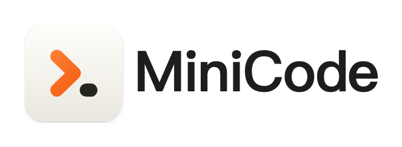
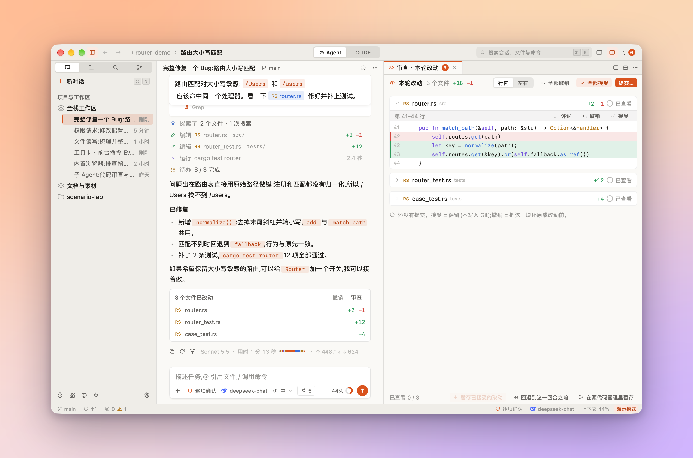
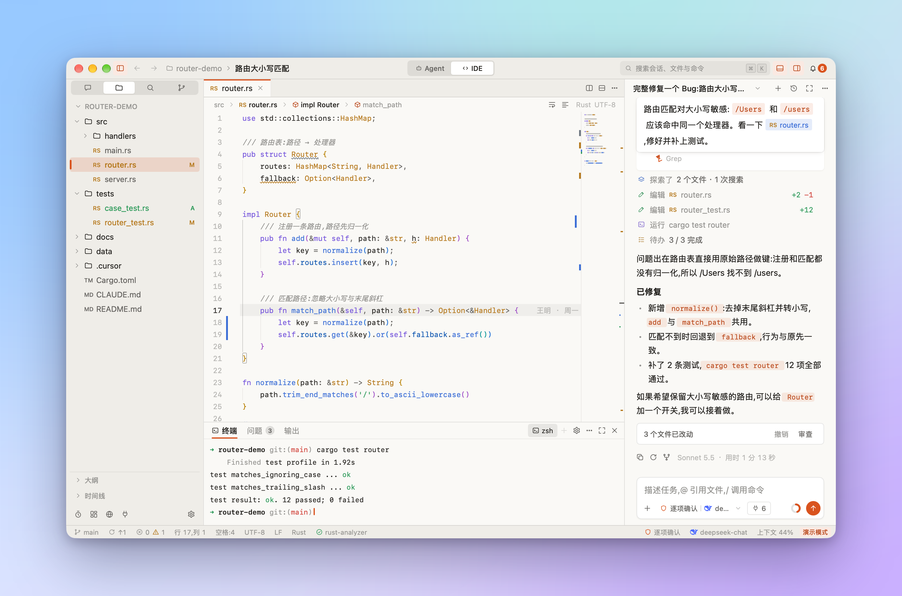
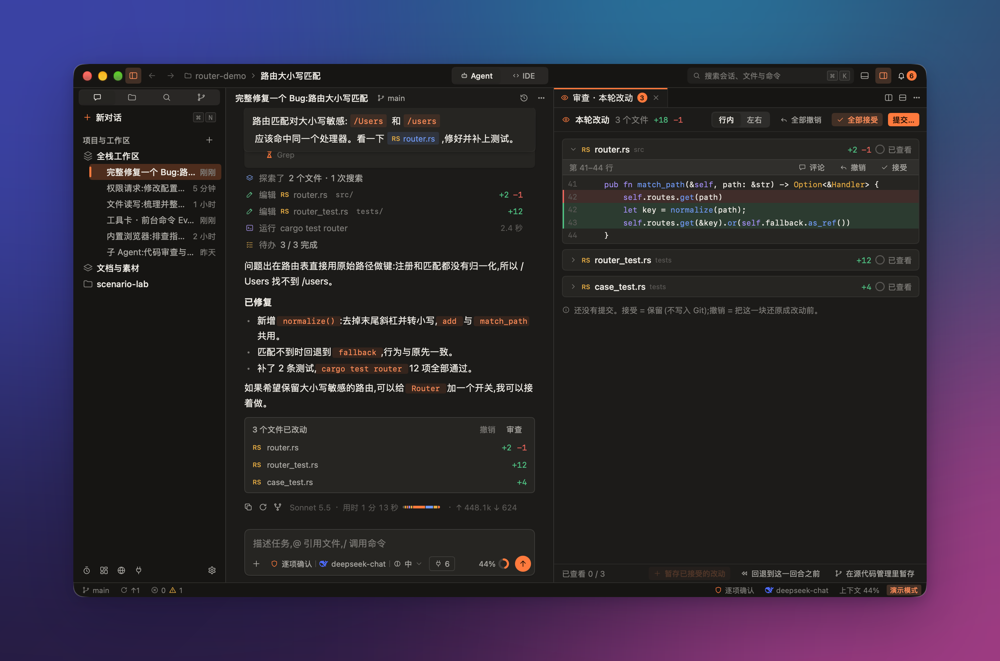
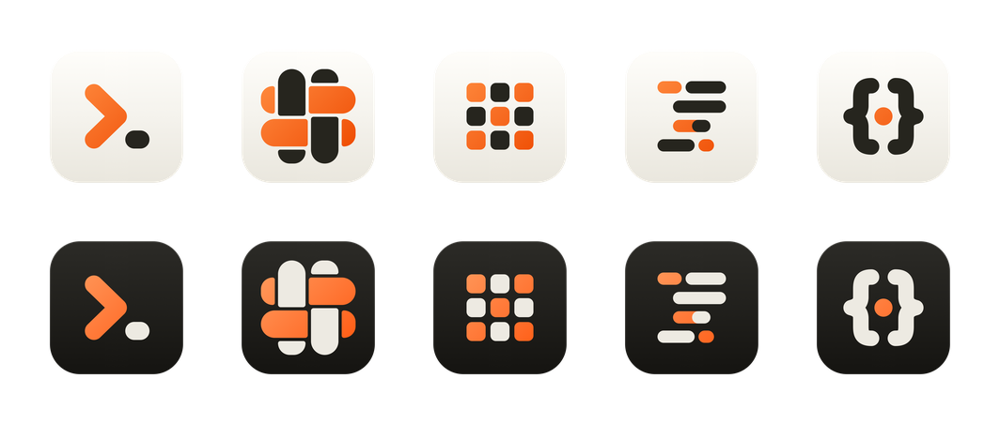
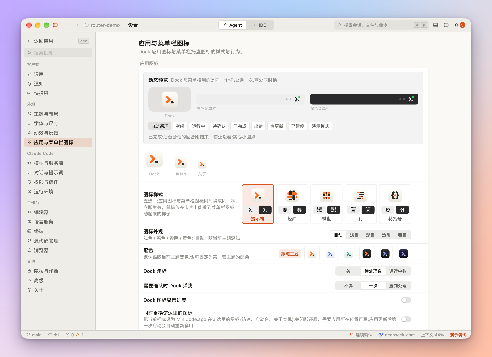
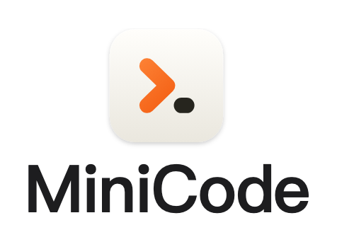

<div align="center">

<picture>
  <source media="(prefers-color-scheme: dark)" srcset="docs/assets/lockup-dark.png">
  
</picture>

**macOS 原生的 Claude Code 工作台**

Agent 与 IDE 是同一个窗口的两种形态,共用一份会话、编辑器和终端。
Go 原生界面,无 WebView、不依赖 Node,直连本机 `claude` 的 stream-json 协议。

[下载最新版](https://github.com/ixxxxoooo/minicode/releases/latest) ·
[设计稿](docs/design) ·
[开发笔记](docs/dev-notes.md)




</div>

> 截图来自**演示模式**(脚本化后端 + 沙盒项目),界面是真实运行中的窗口;演示数据不等于真实能力。
> 大量功能是「代码已写、编译通过、有单测」,但没有在真实环境逐项验证,以设计稿「缺口总表」为准(见文末)。

---

## 它是什么

|  |  |
| --- | --- |
| **Agent 形态** | 会话为主:会话流、工具卡、权限请求、计划、子 Agent、改动审查;右侧是可折叠的工作区(审查 / 计划 / 文件 / 终端 …)。 |
| **IDE 形态** | 编辑器为主:文件树、多标签编辑器(语法高亮、LSP 悬停 / 跳转 / 补全 / 诊断)、终端面板、源代码管理(Git);对话收在右侧。 |
| **一个窗口,两种形态** | 同一份会话、编辑器、终端;切换形态不丢状态。窄窗口自动收起侧栏。 |
| **主题** | 6 套主题 × 3 种布局方案,浅 / 深跟随系统。 |
| **图标与品牌** | 5 种图标样式,应用图标与菜单栏图标始终同步;Dock 角标 / 弹跳 / 进度、菜单栏运行动画、访达里的图标都可设置(见下)。 |
| **其他** | 自动化、画布、内置浏览器、自定义(MCP / Skills / Hooks / 规则)、用量与成本、命令面板、自动更新。 |

<div align="center">

</div>

<div align="center">

</div>

---

## 图标与菜单栏

<div align="center">

</div>

| 样式 | 图形 |
| --- | --- |
| 提示符(默认) | `>_` 命令行 |
| 经纬 | 经线与纬线交织的织纹 |
| 棋盘 | 3×3 方块 |
| 行 | 代码行 |
| 花括号 | `{ }` |

- **一个选择,处处同步**:在「设置 → 应用与菜单栏图标」选一种样式,Dock、⌘Tab、访达、菜单栏同时换成同一种,不会出现两处不一致。
- **动态预览**:设置页里有 Dock + 浅 / 深菜单栏的实时预览,自动循环八种状态(空闲 / 运行中 / 待确认 / 已完成 / 出错 / 有更新 / 已暂停 / 演示),也可固定到某一种;鼠标放在样式卡上能看到菜单栏图标「运行中」的动画。
- **怎么让设置生效**:改完立即套用,不需要重启;页面里的「当前生效」会列出 Dock / 访达 / 菜单栏各自的结果(失败给出原因),哪一处没变就点「重新应用」。
- **访达里的图标**:打开「同时更换访达里的图标」后,会把当前样式写进 `MiniCode.app` 的自定义图标(访达、启动台、关于本机);关闭即还原。应用更新会替换整个 `.app`,所以更新后第一次启动会自动重新套用。已知代价:开启期间 `codesign --verify --strict` 会报 resource fork,不影响启动与自动更新。

<div align="center">

</div>

横版 / 竖版锁定版式(用于关于页、发布页与本文件顶部)由 `scripts/gen-lockup.py` 生成到 `docs/assets/`:

<div align="center">
<picture>
  <source media="(prefers-color-scheme: dark)" srcset="docs/assets/lockup-v-dark.png">
  
</picture>
</div>

---

## 安装与更新

- 从 [Releases](https://github.com/ixxxxoooo/minicode/releases/latest) 下载 `MiniCode-<版本>.dmg`,拖进「应用程序」。
- 应用会检查 `appcast.json` 并提示更新(「设置 → 关于」里可开关自动下载;下载完成后重启生效)。
- 真实模式需要本机装好 `claude` CLI(`PATH` 里能找到,或设 `MINI_CLAUDE_PATH`);演示模式不需要。

---

## 开发

### 环境要求

| 依赖 | 说明 |
| --- | --- |
| macOS 13+(通用二进制:Apple Silicon + Intel) | 部署目标 13.0;目前只在较新的 macOS 上验证过,低版本与 Intel 未实测(cgo 调 AppKit / UserNotifications) |
| Go 1.27.4 | `mygo/go.mod` 指定;用 Homebrew 装的 Go 即可 |
| Xcode 命令行工具 | cgo 需要 `clang`、`codesign` |
| Python 3 + Pillow + PyObjC | 只在重新生成图标 / 截图 / 锁定版式时需要 |
| Google Chrome | 给设计稿出截图、渲染锁定版式 |

**每次执行 Go 命令前先 `unset GOROOT`**(残留的 `GOROOT` 会让工具链对不上)。

### 启动开发版

```sh
scripts/dev.sh --demo     # 演示模式:脚本化后端 + 沙盒项目,不连 claude,不动你的真实数据
scripts/dev.sh --real     # 真实模式:读 ~/.claude/projects,按需惰性启动 claude
scripts/dev.sh            # 不带开关:沿用上次选择,从没选过则是真实模式
```

`dev.sh` 做的事:`go vet` → 编译 → **杀掉所有旧实例** → 在 `target/dev/MiniCode Dev.app` 里启动**唯一**的新实例。编译或 vet 失败时旧实例保持运行。
**不要用 `go run` 另起实例,也不要碰打包版。** 演示与真实各存一份运行状态,互不串。

带环境变量启动(`dev.sh` 会把所有 `MINI_*` 转给应用):

```sh
MINI_MODE=ide MINI_THEME=ink MINI_SCHEME=b scripts/dev.sh --demo
MINI_SCREEN=settings MINI_TAB=brand scripts/dev.sh --demo   # 直接进「应用与菜单栏图标」
```

| 变量 | 作用 |
| --- | --- |
| `MINI_DEMO=1\|0` | 强制演示 / 真实 |
| `MINI_MODE=ide` | 启动进 IDE 形态 |
| `MINI_THEME` / `MINI_SCHEME` | 主题 id / 布局方案 a、b、c |
| `MINI_SCREEN` / `MINI_TAB` | 启动直接进某个屏幕(settings / usage / automation …)/ 设置里的某个分类(brand / about …) |
| `MINI_SESSION=<id>` | 启动打开指定会话(演示里 `fixbug` 是那条完整的修 Bug 会话) |
| `MINI_OPEN=review` / `MINI_ED=<动作>` | 演示启动后打开审查标签 / 执行编辑器动作(同 `cmd/shot -ed`,如 `goto:src/router.rs:17`) |
| `MINI_WS=1` | 启动即进入演示工作区「全栈工作区」 |
| `MINI_WIN_W` / `MINI_WIN_H` / `MINI_WIN_X` / `MINI_WIN_Y` | 窗口尺寸 / 位置(配合 `--new-window` 才不被上次的窗口位置覆盖) |
| `MINI_HOME=<目录>` | 数据目录(默认 `~/.minicode`);截图脚本用全新目录,免得带上本机改过的偏好 |
| `MINI_TRAY=<状态>` | 强制菜单栏图标显示某个状态 |
| `MINI_DEMO_SLOW` | 演示实时播放的慢放倍数 |
| `MINI_CLAUDE_PATH` | 指定 `claude` 可执行文件 |
| `MINI_LOG=off\|error\|warn\|info\|debug` | 临时覆盖日志级别 |

### 日志与数据

| 位置 | 内容 |
| --- | --- |
| `~/.minicode/logs/minicode.log` | 应用日志(`diag.L("包名")`) |
| `target/dev.log`(上一个在 `dev.log.prev`) | 标准错误、帧统计 |
| `~/.minicode/crashes/` | panic、崩溃、卡死记录 |
| 设置 → 隐私与诊断 | 资源曲线、慢操作统计、崩溃列表、导出诊断包 |

数据全在 `~/.minicode/`:`settings.json`(偏好)、`workspaces.json`、`session-meta.json`、`automations.json`、`providers.json` + `provider-keys.json`(**0600,密钥只在这里**)、`canvases/` 等。应用**不读取、不输出**任何密钥;环境变量只展示名称。

### 用真实 claude 跑(DeepSeek 代替官方模型)

```sh
scripts/with-deepseek.sh scripts/dev.sh --real
cd mygo && MINI_REAL_CLAUDE=1 ../scripts/with-deepseek.sh go test ./internal/claude -run Real
```

先在应用「设置 → 模型与服务商」给 DeepSeek 填好密钥;`with-deepseek.sh` 运行时从 `~/.minicode/provider-keys.json` 读取并注入环境变量,**密钥不进仓库 / 日志 / 提交**。

### 测试与截图

```sh
cd mygo && unset GOROOT
gofmt -l . ; go vet ./... && go test ./...
```

- 界面用 `ui.Tester` 写测试(`internal/app/*_test.go`)。真实 claude 的集成测试默认跳过,要 `MINI_REAL_CLAUDE=1`。
- 构建缓存会长到几个 GB;报 `no space left on device` 时先 `go clean -cache`。
- **无窗口截图** `cmd/shot`(辅助排查,不能代替实测):`go build -o /tmp/shotbin ./cmd/shot && /tmp/shotbin -screen settings -tab brand -o /tmp/x.png`;常用参数 `-scheme` `-theme` `-mode` `-screen` `-state`(welcome / perm / ask / plan / queue … 或 `scn:<场景 id>`)`-popup` `-click` `-tab` `-ed`,`-h` 看全部。
- **设计稿截图**(对照用):`scripts/proto-shot.sh <页面> <方案> <主题> <形态> <输出.png>`;`scripts/compare.sh work agent a:paper b:mist c:ink` 并排对比。
- **README 截图**:`scripts/readme-shots.py [agent|ide|dark|icons]` 用演示模式启动真实窗口、截图并合成到渐变背景上,输出 `docs/assets/shot-*.png`(需要给终端开「屏幕录制」权限)。
- **锁定版式 / 样式条**:`scripts/gen-lockup.py` 生成 `docs/assets/lockup*.png` 与 `icon-styles.png`。
- **图标资源**:`assets/icon/gen.py` 出 SVG,`build_all.sh` 渲染 PNG / `.icns` / 托盘图并同步到 `mygo/internal/app/brandassets/`(内嵌进二进制)。

### 打包与发布

```sh
scripts/package.sh [--dmg]    # 正式版 dist/MiniCode.app(--dmg 另出 dist/MiniCode-<版本>.dmg),版本取 mygo/main.go 的 version
scripts/publish.sh            # 先改 main.go 版本号并提交推送;脚本在干净 HEAD 检出里打包 → appcast.json → tag → gh release;MINI_DRY_RUN=1 只演练
```

### 目录结构

| 路径 | 职责 |
| --- | --- |
| `mygo/internal/core` | 与界面无关的数据模型:时间线条目、`Event` / `Command`、`State.Apply` 归约器 |
| `mygo/internal/backend` | `Backend` 抽象(`Start(sink)` / `Send(cmd)` / `Close()`) |
| `mygo/internal/claude` | 真实后端:stream-json 协议、翻译器、惰性启动与崩溃自动 `--resume`、历史回放、会话索引 |
| `mygo/internal/demo` | 演示后端:脚本化场景、沙盒项目、演示仓库 |
| `mygo/internal/app` | **全部界面**:会话流 / 输入框 / IDE / 终端面板 / 源代码管理 / 设置 / 命令面板 / 品牌图标等 |
| `mygo/internal/kit` / `theme` | 控件与设计令牌(6 套主题 × 3 种布局) |
| `mygo/internal/lsp` / `term` / `vcs` | 语言服务器客户端 / 终端内核(pty + 仿真器)/ Git 访问 |
| `mygo/internal/workspace` / `projects` | 文件系统抽象 / 项目与工作区存储 |
| `mygo/internal/mermaid` | Mermaid 解析与排版(流程 / 时序 / 饼 / 状态图) |
| `mygo/internal/diag` | 日志、慢操作计时、崩溃与卡死看门狗 |
| `mygo/cmd/shot` | 无窗口截图工具 |
| `docs/design` | 设计稿(HTML 原型,浏览器打开 `index.html`) |
| `docs/assets` | README 用的截图与锁定版式 |
| `scripts/` | `dev.sh` `package.sh` `publish.sh` `make-app.sh` `proto-shot.sh` `compare.sh` `with-deepseek.sh` `readme-shots.py` `gen-lockup.py` `gen-icons.mjs` `gen-logos.py` |
| `assets/icon/` | 图标源与产物(五样式 × 四外观、托盘、文档图标) |

数据流:`Backend` → `core.Event` → `core.State.Apply` → 界面;界面交互转成 `core.Command` 交回后端。演示与真实后端共用同一套界面。

### 开发约定

- 回答、注释、文档、提交信息一律中文;提交用 Conventional Commits(`feat:` / `fix:` …),**一个功能一个提交**,改完立刻 `git push origin HEAD`。
- **设计稿 `docs/design` 是界面的唯一依据**,先改设计稿再写代码;设计稿「缺口总表」页由各页「实现状态」自动汇总(数据主要在 `js/status.js`)。
- 并行 / 多会话开发时只按路径 `git add` 自己改的文件;提交后用干净检出验证 HEAD 能编译。
- 日志一律 `diag.L("包名")`;耗时操作用 `diag.SpanSlow`;后台任务经 `a.bg(name, work)`。
- 不提交 `target` / `dist`;不读取、不输出密钥。
- 三阶段工作流(补缺口 → 逐项审查 → 集中测试)与「必踩的坑」见 [`AGENTS.md`](AGENTS.md),历史做法与已知缺口见 [`docs/dev-notes.md`](docs/dev-notes.md)。

---

## 缺口与进度

- 缺口总表:设计稿「缺口总表」页,数据来自各页「实现状态」。
- 汇报口径:区分 **已实现 / 部分 / 未做 / 未测试**;演示数据不等于真实能力。
- 当前明确**未做**:语义高亮(MyGo 无前景着色 API)、Mermaid 的 gantt / 类图 / ER 图、`perm.sandbox` 与 `adv.flowMeasure` 只存偏好不生效。

## 常见问题

| 现象 | 处理 |
| --- | --- |
| `dev.sh` 在 vet 阶段失败 | 先修 vet 报错;旧实例仍在运行 |
| 报 `no space left on device` | `go clean -cache` 释放构建缓存 |
| 工具链版本对不上 | `unset GOROOT` |
| 改了图标设置没变化 | 设置 → 应用与菜单栏图标 →「当前生效」看哪一处失败,点「重新应用」 |
| 设置页「崩溃与卡顿」里出现 `unclean-exit` | `dev.sh` 重启杀旧实例留下的记录,不是真崩溃 |
